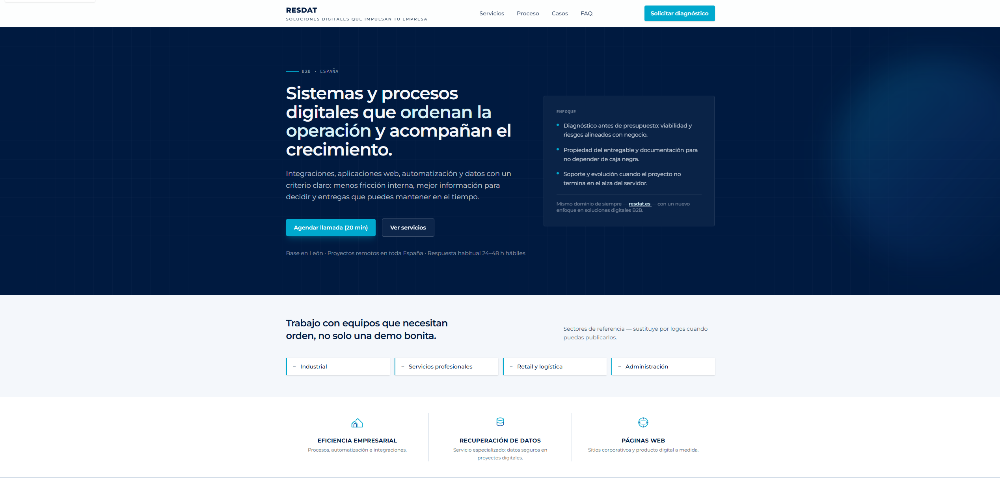

<div align="center">

# RESDAT — Corporate Landing

**Static corporate website for B2B digital solutions**

[](https://astro.build/)
[](https://tailwindcss.com/)
[](https://vitejs.dev/)
[](https://nodejs.org/)
[](https://pnpm.io/)

[Live Site](https://www.resdat.es/) · [Report a Bug](https://github.com/Cesarks81/RESDAT/issues) · [Request a Feature](https://github.com/Cesarks81/RESDAT/issues)

</div>



---

## Table of Contents

- [Description](#description)
- [Features](#features)
- [Tech Stack](#tech-stack)
- [Architecture](#architecture)
- [Prerequisites](#prerequisites)
- [Installation & Setup](#installation--setup)
- [Usage](#usage)
- [Project Structure](#project-structure)
- [Deployment](#deployment)

---

## Description

RESDAT is a static corporate landing page for a B2B digital solutions brand. Built with Astro's static output mode, it generates pure HTML and CSS at build time — ideal for hosting on a CDN or any static file server. The site includes the main landing page, a legal notice, and a privacy policy.

---

## Features

### Landing Page
- Responsive, modern design with Tailwind CSS
- Brand assets: custom logo, favicon, and background
- Typography powered by Montserrat via Google Fonts
- Contact form integrated with Formspree (no backend required)

### Legal Pages
- Legal notice (`/aviso-legal`)
- Privacy policy (`/politica-privacidad`)
- Shared layout component for consistent legal page structure

### Performance & Build
- Static output — pure HTML/CSS, zero JavaScript runtime
- Optimized asset pipeline via Vite (bundled with Astro)
- Ready for CDN deployment or any static host

---

## Tech Stack

| Layer | Technology | Version |
|---|---|---|
| Framework | Astro | 6.x |
| Styling | Tailwind CSS | 4.x |
| Vite integration | @tailwindcss/vite | 4.x |
| Build tool | Vite (included with Astro) | — |
| Runtime | Node.js | ≥ 22.12 |
| Package manager | pnpm | — |
| Typography | Montserrat (Google Fonts) | — |
| Contact form | Formspree | — |

---

## Architecture

```
┌─────────────────────────────────────────────────┐
│                 Client (Browser)                │
│            Pure HTML + CSS (no JS runtime)      │
└─────────────────────────────────────────────────┘
                         ▲
                   Static files
┌─────────────────────────────────────────────────┐
│              CDN / Static Host                  │
│     Serves pre-built output from dist/          │
└─────────────────────────────────────────────────┘
                         ▲
                   astro build
┌─────────────────────────────────────────────────┐
│             Astro (build time)                  │
│  Pages → Layouts → Components → Tailwind CSS   │
└─────────────────────────────────────────────────┘
```

Astro's **static output** mode processes all `.astro` files at build time, producing a `dist/` folder of plain HTML and CSS. There is no server-side rendering at runtime.

---

## Prerequisites

- **Node.js** ≥ 22.12
- **pnpm** — install with `npm install -g pnpm`

---

## Installation & Setup

### 1. Clone the repository

```bash
git clone https://github.com/Cesarks81/RESDAT.git
cd RESDAT
```

### 2. Install dependencies

```bash
pnpm install
```

### 3. Start the development server

```bash
pnpm dev
```

The site will be available at `http://localhost:4321`.

### 4. Build for production

```bash
pnpm build
```

The static output is generated in `dist/`. Preview it locally with:

```bash
pnpm preview
```

---

## Usage

### Development

Run `pnpm dev` to start the local dev server with hot-reload. Edit any `.astro` file under `src/` and changes will reflect instantly.

### Contact Form

The contact form on the landing page posts to a Formspree endpoint. To use your own:

1. Create a free account at [formspree.io](https://formspree.io/).
2. Create a new form and copy the endpoint URL.
3. Replace the `action` URL in `src/pages/index.astro` with your endpoint.

### Legal Pages

The legal notice and privacy policy are under `/aviso-legal` and `/politica-privacidad`. Update the content in the corresponding `.astro` files to match your business details.

---

## Project Structure

```
RESDAT/
├── public/
│   ├── favicon.ico
│   └── favicon.svg               # Served as-is (no processing)
│
├── src/
│   ├── assets/                   # Processed by Vite at build time
│   │   ├── background.svg
│   │   ├── favicon.ico
│   │   ├── favicon.png
│   │   └── resdat-marca.png      # Brand logo
│   │
│   ├── components/
│   │   └── LegalPageShell.astro  # Shared wrapper for legal pages
│   │
│   ├── layouts/
│   │   └── Layout.astro          # Base HTML template and metadata
│   │
│   ├── pages/
│   │   ├── index.astro                  # Main landing page
│   │   ├── aviso-legal.astro            # Legal notice
│   │   └── politica-privacidad.astro   # Privacy policy
│   │
│   └── styles/
│       └── global.css            # Tailwind entry point and brand theme tokens
│
├── astro.config.mjs              # Astro + Tailwind/Vite configuration
├── tsconfig.json
└── package.json
```

---

## Deployment

The project generates a fully static `dist/` folder compatible with any static hosting provider.

### Option 1 — Vercel

```bash
# Install Vercel CLI
npm i -g vercel

# Deploy from the project root
vercel --prod
```

### Option 2 — Netlify

Connect the repository and set:
- **Build command:** `pnpm build`
- **Publish directory:** `dist`

Or drag and drop the `dist/` folder directly into the Netlify dashboard.

### Option 3 — Any static host

Upload the contents of `dist/` to any web server, CDN (Cloudflare Pages, GitHub Pages, etc.), or S3 bucket configured for static hosting.

---

<div align="center">

Developed by [César Ramos Morón](https://github.com/Cesarks81)

</div>
